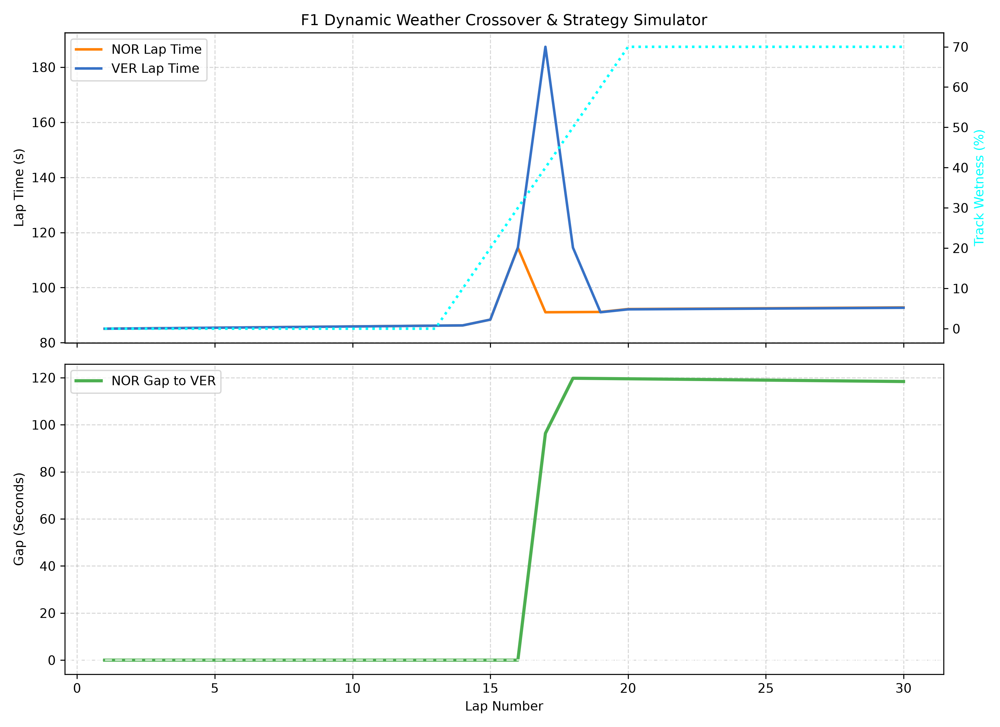

# 🏎️ F1 Pit Stop, Undercut & Dynamic Weather Strategy Simulator

An object-oriented F1 race strategy engine written in Python. Models lap pace progression, pit lane time loss, cold out-lap penalties, tire degradation curves, real telemetry fitting via FastF1, and dynamic weather crossovers (Dry ➔ Intermediate ➔ Wet).

## 🚀 Key Features

* **Object-Oriented Architecture**: Clean encapsulation of `TyreCompound`, `ReactiveCar`, `WeatherProfile`, and `WeatherSimulator` classes.
* **Dynamic Weather & Crossover Strategy**: Models compound grip windows and exponential pace decay when running slicks on wet track surfaces to calculate optimal pit stop timing.
* **FastF1 Telemetry Integration**: Scrapes real Grand Prix session timing data and fits compound degradation parameters using `scipy.optimize.curve_fit`.
* **Visual Telemetry Plotting**: Generates multi-panel Matplotlib charts tracking lap pace, track moisture percentage, and driver gap evolution.

## 📊 Weather Crossover Simulation Output



## 🛠️ Installation & Setup

1. **Clone the repository:**
   ```bash
   git clone [https://github.com/YOUR-USERNAME/f1-undercut-simulator.git](https://github.com/YOUR-USERNAME/f1-undercut-simulator.git)
   cd f1-undercut-simulator
